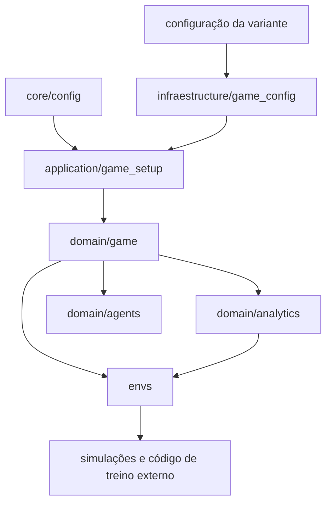

# Arquitetura e organização dos pacotes

Este guia explica onde cada responsabilidade vive e como uma configuração se
transforma em uma partida. A árvore abaixo documenta as interfaces práticas
entre os pacotes do código atual.

## Visão geral



O domínio do jogo é o centro: valida e executa ações sem depender de Gymnasium,
PettingZoo ou de um algoritmo de agente. Os ambientes adaptam o domínio a
interfaces de RL. Analytics calcula informação derivada sem escolher ações pelo
agente.

## Mapa de pacotes

| Caminho | Responsabilidade | Entradas principais |
|---|---|---|
| `app/core/` | Configuração do processo e caminhos da variante | `get_app_settings()` |
| `app/infraestructure/game_config/` | Leitura, modelos e validação dos JSONs | `load_game_config()` |
| `app/application/` | Construção de tabuleiro, regras, jogadores e loop | `create_game()` |
| `app/domain/game/` | Estado, regras, ações, cartas, leilões, trocas e dívidas | `GameState`, `GameLoop`, `GameAction` |
| `app/domain/analytics/` | Markov, valuation, forecasts e features | `evaluate_candidate()`, `DecisionFeaturesEncoder` |
| `app/domain/agents/` | Protocolos de políticas e geradores de candidatas | `Agent`, `RLAgent`, `FeaturePolicy` |
| `app/envs/` | Gymnasium, PettingZoo, observações, ações, baselines e simulador | `MonopolyGymEnvV2`, `pettingzoo_env_v2`, `simulate` |
| `app/training/` | Treinador experimental PPO mascarado para ações candidatas | `PPOTrainingConfig`, `train_ppo()` |
| `app/api/` | Dependências preparatórias para integração futura | Ainda sem endpoints HTTP |
| `agents/` | Documentação do estado dos agentes e do treinamento | `agents/README.md` |
| `configs/games/` | Variantes declarativas de tabuleiro, cartas e regras | `classic_us/` |
| `tests/` | Regras, invariantes, analytics e contratos dos ambientes | `pytest` |

`infraestructure` preserva o nome já usado pelos imports. Uma mudança deve ser
tratada como migração de API e atualizar os imports em conjunto.

## Subpacotes de analytics

`app/domain/analytics/` agrupa cálculos pelas perguntas que respondem:

- `markov/`: estados do tabuleiro e probabilidades estacionárias ou de passagem;
- `economics/`: tráfego, renda, valuation, leilões, trocas, dívidas e forecasts;
- `decisions/`: oportunidades específicas, como sair da prisão;
- `statistics/`: simulações, intervalos de confiança e ajuste estatístico;
- `valuation/`: interfaces de valuation reutilizáveis;
- módulos na raiz: contexto de decisão e codificação de features.

Os cálculos devolvem resultados explícitos. Uma previsão depende de hipóteses
como horizonte, seed e política de continuação; não é uma recomendação.

## Como uma partida é criada

1. `get_app_settings()` escolhe a variante usando `MONOPOLY_GAME_VARIANT`
   (padrão `classic_us`).
2. `load_game_config()` carrega e valida os arquivos. `settings.json` fornece
   valores e flags de regras; `board.json` define casas, grupos e aluguéis.
3. `create_game()` constrói os objetos de domínio e inicializa aleatoriedade a
   partir da seed.
4. `GameLoop.legal_actions()` lista decisões legais; `validate()` explica por
   que uma ação não pode ser executada; `process_action()` aplica ações válidas.
5. Um consumidor pode interagir diretamente com o loop ou usar `app/envs/`.

## Como uma decisão de RL chega ao motor

```text
GameLoop / GameState
        ├── Gymnasium v2 ── ObservationEncoderV2 + StructuredActionSpace
        │                           └── ator RL ou política
        ├── PettingZoo AEC v2 ── observação e máscara do agente da vez
        └── CandidateSelectionEnv ── escolha discreta de ação legal
                                      + análise opcional de trocas
```

`action_mask` informa a legalidade atual; máscaras condicionais restringem
parâmetros de ações estruturadas. `evaluate_candidate()` e
`DecisionFeaturesEncoder` fornecem dados condicionais. `CandidateSelectionEnv`
apresenta candidatas legais como índices discretos e pode calcular features de
troca sob demanda.

O projeto inclui baselines, utilitários de rollout e um treinador experimental
de PPO categórico mascarado em `app/training/`. O treinador ainda não inclui
gerenciamento de experimentos nem self-play; não há agente treinado versionado.
`app/api/` ainda não contém uma API HTTP de partidas.

## Dependências entre camadas

- `domain/game` não importa adaptadores de RL ou lógica de treinamento.
- `application` conhece a configuração e instancia objetos de domínio.
- `analytics` lê estado/configuração; ambientes podem expor seus resultados.
- `envs` traduz ações e observações externas, mantendo o motor como autoridade
  de legalidade.
- `agents` define protocolos que algoritmos ou frameworks externos podem
  implementar.

## Documentação relacionada

- [README do projeto](../readme.md): instalação e primeiros passos.
- [Ambientes e regras](ambiente.md): contratos v1/v2 e limitações.
- [Contrato de agente](contrato-agente-rl-v1.md): ciclo de decisão e integração.
- [Contrato de observação v2](contrato-observacao-rl-v2.md): semântica e
  privacidade dos campos observados.
- [Informações para decisão](informacoes-de-decisao.md): forecasts e features.
- [Histórico da release v1](release-v1.md): escopo original da primeira versão.
